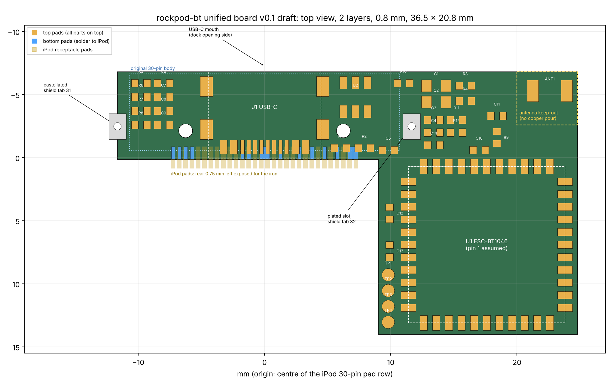

# Unified board v0.1: schematic and first-pass layout

KiCad 8 project for EasyEDA Pro import: the complete schematic and a placed (not yet routed) 2-layer PCB. All parts are SMD on the top side. The underside carries only the pads that solder to the iPod.



> **Draft for review, not for ordering.** Two footprints are placeholders (see "Assumptions"), and the geometry has to be checked against measured iPods (roadmap step 1). Routing comes after both are settled.

## Files

| File | What it is |
| --- | --- |
| `rockpod-bt-board.kicad_sch` | Full schematic. Nets connect by label name. Every part has an `LCSC` / `Supplier Part` field. |
| `rockpod-bt-board.kicad_pcb` | Board outline, placed footprints with nets (ratsnest), iPod interface pads, shield tabs, alignment holes, top GND pour and antenna keep-out. |
| `rockpod-bt-board.kicad_pro` | Project file. |
| `board-preview.png` | Plot of the placement. |
| `tools/` | Python generator. Edit `design.py` (geometry, parts, placement) and rerun to regenerate everything. |

## Importing into EasyEDA Pro

1. *File → Import → KiCad*, and select `rockpod-bt-board.kicad_pro` (or the `.kicad_sch` and `.kicad_pcb`).
2. **Replace U1 and J1 with EasyEDA library parts:**
   - U1: search `C9900132912` (FSC-BT1046).
   - J1: an all-SMD 16-pin USB-C receptacle (see below).

   Then *Update PCB from schematic*. Every other footprint is a standard 0402, 0603, SOT-23-6 or 1206 land pattern.
3. Check the board against the "Assumptions" list, then route with the rules below.

## Board

- **2 layers, 0.8 mm FR4.** 36.5 × 20.8 mm, L-shaped.
- **Main strip** sits in the 30-pin receptacle's place. It carries the USB-C port, USB ESD protection, the CC resistors and the audio front end.
- **Extension** reaches back into the case on one side only, as decided, to stay clear of the logic board's other connectors. It carries the Bluetooth module, its supply parts, the RF filter and the antenna. Everything sits in `design.py`, so it can be mirrored to the other side once the iPods are measured.
- **Rear edge over the pad row** stops 0.125 mm past the pad centreline, leaving the rear 0.75 mm of each iPod pad exposed for a fine-tip iron.
- **Underside pads run flush to that rear edge** (0.28 × 1.0 mm), so solder flows straight from the exposed iPod pad onto ours. This breaks the usual 0.2 mm copper-to-edge rule on purpose:
  - Mark it as accepted in EasyEDA's DRC.
  - Add an order note for JLCPCB not to trim the bottom pads on the rear edge.
- **Shield tabs:** tab 31 (left) is castellated on the board edge. Tab 32 (right) falls inside the extension, so it gets a plated slot instead, which solder fed from the top flows through.
- **Alignment holes:** two 1.1 mm holes match the iPod's receptacle locating holes at x = ±6.25 mm.
- **Antenna:** the module has no antenna of its own. The FSC-BT1046 datasheet says to connect a 50 Ω antenna to RF_IO (pin 7). A chip antenna sits at the front corner, the side facing the dock opening, with a pi-match (R9 fitted with 0 Ω; C10 and C11 left unfitted for tuning) and a copper keep-out on both layers.

## Assumptions to check first

1. **U1 pin 1 position.** The FSC-BT1046 datasheet's text gives the pin table, the 1.0 mm pitch and the 12.4 mm body, but not where pin 1 sits. This footprint assumes pin 1 at the front-left corner, numbered counter-clockwise. The EasyEDA library footprint for C9900132912 settles it, and parts around the module may need to move once it's in.
2. **J1 must be an all-SMD USB-C.** The HRO TYPE-C-31-M-12 in the BOM has through-hole shell legs, which would poke through the underside that sits on the iPod. The J1 footprint here is a generic 16-pin land pattern with four SMD shell tabs.
3. **USB-C depth.** A USB-C receptacle is about 7.35 mm long. The 30-pin body was about 6.6 mm deep, and the board can't run past the pad row. So the USB-C mouth sits 0.45 mm proud of the board front, about 0.6 mm past where the 30-pin mouth was. Check that against the case opening.
4. **Case clearance.** Check the extension (x = 9 to 24.8 mm, y up to 14 mm behind the pad row) against parts on the logic board and the curve of the case corner.
5. **Pad positions.** The iPod pad row comes from SparkFun's footprint. The contact row in the 3D model in `../reference/ipod-30pin/3d` agrees: 30 tails at 0.5 mm pitch, centred ±7.25 mm.
6. **Shield tabs are ground,** on each generation.

## Routing rules

- **AGND (iPod pin 2) never touches GND.** Keep it off the ground pour. It splits into two return traces, one for each audio pair.
- **Audio pairs:**
  - Route LINE_L/AGND → R5/R6 → C6/C7 → AUD_L_P/AUD_L_N, and LINE_R/AGND → R7/R8 → C8/C9 → AUD_R_P/AUD_R_N, as tightly coupled pairs of about equal length, each pair kept apart from the other.
  - C12 and C13 go right at the module pins.
  - Keep the pairs away from USB D+/D−, RF_MOD/RF_ANT and the antenna.
- **USB D+/D−:** a 90 Ω differential pair from J1 through U2 to the iPod pads 25/27, kept short.
- **iPod interface pads (underside):** USB-C pads sit directly above several of them. Fan the bottom pads out on the bottom layer first, then via up to the top clear of J1's pads. Vias under the USB-C body must be tented.
- **Underside copper:** don't pour on the bottom layer, since it sits on the iPod logic board. Keep bottom traces short and under solder mask.
- **RF:** RF_MOD → R9 → RF_ANT as a short 50 Ω coplanar line over the top ground pour, stitched with GND vias. No copper of either layer inside the antenna keep-out.
- **Power:** VACC (pad 18) to C1/C2 (bulk) and C3 (VBAT) / C4 (PIO_POWER) close to the module pins.
- **Checks after soldering:** see `../DESIGN.md`.

## Regenerating

```bash
cd hardware/pcb/tools
python3 gen.py ..                      # writes the .kicad_sch / .kicad_pcb / .kicad_pro, prints clearance checks
python3 validate.py ..                 # parses the files, cross-checks schematic vs PCB nets
python3 render.py ../board-preview.png
```
