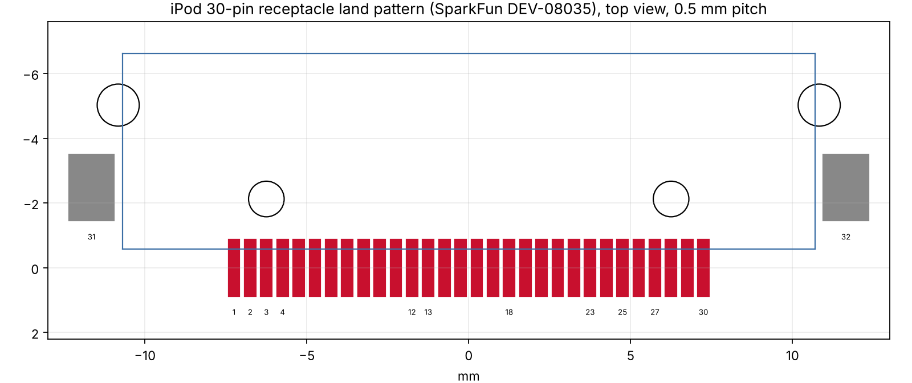

# Apple iPod 30-pin dock connector: reference footprint and symbol

Reference CAD for the 30-pin receptacle that sits on the iPod logic board. The USB-C + Bluetooth board replaces this part and solders onto its pads, so this land pattern is the starting point for the board's mating pads.

> **Not verified against an iPod.** These come from SparkFun's retired part DEV-08035, a 30-pin receptacle that SparkFun describes as "the connector found inside current iPods". SparkFun marks the footprint "not production proven". Measure the pads on a real 5G, 6G and 7G logic board before designing to it (roadmap step 1).

## Files

| File | What it is |
| --- | --- |
| `SparkFun-iPod-30pin.lbr` | Eagle library with SparkFun's original parts, unchanged: the female receptacle (`IPOD_FEMALE_CONNECTOR`), the male plug (`IPOD_MALE_CONNECTOR`) and their symbol. KiCad can import it directly (*File → Import → Eagle library*). |
| `Apple_iPod_30pin_Receptacle_P0.5mm_SparkFun.kicad_mod` | KiCad footprint converted from the receptacle package. |
| `iPod_30pin.kicad_sym` | KiCad symbol with the pins named from the pinout below. |
| `footprint.png` | Plot of the KiCad footprint. |

## Land pattern (from the SparkFun package)

- **Signal pads:** 30 SMD pads in one row, **0.5 mm pitch**, each 0.35 × 1.75 mm. Pad 1 is at x = −7.25 mm, pad 30 at x = +7.25 mm.
- **Mounting pads:** two SMD tabs (31, 32), 1.4 × 2.05 mm, centered at x = ±11.65 mm, 2.475 mm behind the signal row.
- **Holes (unplated):** two 1.1 mm locating holes at x = ±6.25 mm, 2.125 mm back, and two 1.3 mm holes at x = ±10.825 mm, 5.025 mm back.
- **Body outline:** 21.4 × 6.05 mm.

## Pinout

Pin numbers follow the common pinouts.ru / iFixit tables. Some sources number the pins in reverse (1 ↔ 30), so check pin 1 on the board against a known ground before trusting the order.

| Pin | Signal | Used by the mod |
| --- | --- | --- |
| 1, 2 | Ground; pin 2 is audio/video ground | Ground, audio reference |
| 3 / 4 | Line out R / L | Bluetooth line-in |
| 5 / 6 | Line in R / L | — |
| 8, 9, 10 | Composite / S-video out | — |
| 11 | Serial ground | — |
| 12 / 13 | Serial TX / RX (3.3 V) | Bluetooth UART |
| 15, 16 | Ground / USB ground | Ground |
| 18 | 3.3 V accessory power | Bluetooth supply |
| 19, 20 | FireWire 12 V | — |
| 21 | Accessory ID | Unfitted resistor footprint |
| 22, 24, 26, 28 | FireWire data | — |
| 23 | USB 5 V | USB-C VBUS |
| 25 / 27 | USB D− / D+ | USB-C data |
| 29, 30 | FireWire ground | Ground |
| 7, 14, 17 | Reserved | — |

## 3D model

`3d/Iphone4s-Socket.STEP` (with a rendering) is the free "Iphone 30pin Socket Connector" model from GrabCAD, author Ryan (2016). It's a model of the **iPhone 4S** dock socket, not the iPod Classic's, so use it with care:

- **Contacts match.** 30 tails at 0.5 mm pitch, centred at x = ±7.25 mm, the same as the SparkFun land pattern above.
- **Size is close.** The body is about 6.7 mm deep and 3.9 mm tall above the board. The contact tails sit along the edge opposite the mouth.
- **Mounting differs.** Its screw ears reach x = ±16 mm and its locating pegs sit at about x = ±9.7 mm, 0.7 mm below the board. The iPod's locating holes are at ±6.25 mm.

It is redistributed here for reference under GrabCAD's community terms. Remove it if those terms don't allow that.

## Sources and license

- SparkFun Eagle Libraries, `SparkFun-Retired.lbr`, parts `IPOD_CONNECTOR_FEMALE` / `IPOD_CONNECTOR_MALE` (SparkFun SKUs DEV-08035 and DEV-00633): <https://github.com/sparkfun/SparkFun-Eagle-Libraries>
- The Eagle library and the KiCad files derived from it are licensed under **Creative Commons Attribution-ShareAlike 4.0** (<https://creativecommons.org/licenses/by-sa/4.0/>), the license of the SparkFun library. They are not covered by the GPL that applies to the firmware in this repository.
- Pinout: pinouts.ru and iFixit's dock connector pinout.
